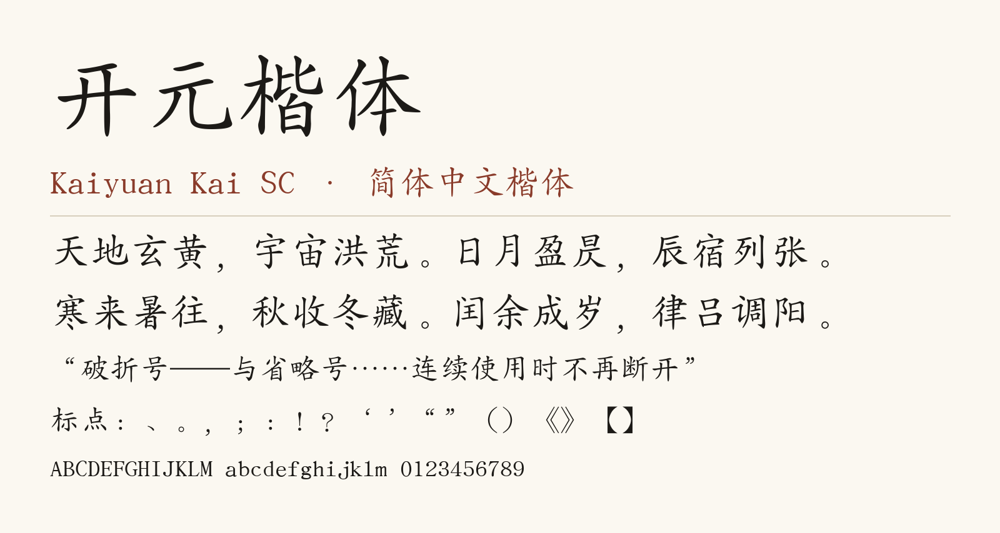

# 开元楷体 网页字型 ／ Kaiyuan Kai SC Webfonts

[简体中文](#简体中文) · [English](#english)



---

## 简体中文

开元楷体（Kaiyuan Kai SC）的按字频切片的 woff2 网页字型。这是一套面向简体中文的
合并楷体，生成自
[daizhige-org/kaiyuan-kai](https://github.com/daizhige-org/kaiyuan-kai)：

| 来源 | 作用 | 码位 |
|------|------|------|
| 文鼎简中楷（`gkai00mp.ttf` 2.11） | 基底：GB 字集，原生简体字形，覆盖到的码位一律采用 | 7,574 |
| AR PL UKai CN face（`ukai.ttc` 0.2.20080216.2） | 补齐简中楷没有的码位 | 16,301 |
| **合计** | 字族 `Kaiyuan Kai SC`，字重 400 | **23,875** |

### 使用方式

建议从 jsDelivr 载入（本包约 9 MB）：

```html
<link rel="stylesheet" href="https://cdn.jsdelivr.net/npm/@free-fonts/kaiyuan-kai-sc@0.0.2/kaiyuan-kai-sc.css">
```

unpkg 等效：

```html
<link rel="stylesheet" href="https://unpkg.com/@free-fonts/kaiyuan-kai-sc@0.0.2/kaiyuan-kai-sc.css">
```

或者 `npm install @free-fonts/kaiyuan-kai-sc` 后自行托管 `kaiyuan-kai-sc.css`
与 `fonts/`：

```html
<link rel="stylesheet" href="./kaiyuan-kai-sc.css">
```

```css
body {
  font-family: 'Kaiyuan Kai SC', cursive, serif;
}
```

CSS 以 `unicode-range` 切片，浏览器只会下载页面实际用到的分片。分片按字频
分层：ASCII 与中文标点一片；最常用的 1,000 个汉字每片 250 字，其后 2,500 字
每片 128 字，其余每片 64 字。常用字集中在少数几片里，一篇普通文章只需下载
1 MB 左右。

### 相比上游的改进

- **字集合并**：简中楷的正确简体字形 + UKai 的覆盖范围。UKai 的 CN face
  实际沿用台湾字形，因此只用来补缺，不覆盖简中楷已有的字形。
- **破折号／省略号接续**：`——`、`……` 连用时不再断开，省略号六点间距均匀。
- **标点纵向位置**：`、。，；：！？` 下移至基线以下，引号 `“”‘’` 上移，贴近
  现代简体排版习惯。
- **垂直度量表**：`hhea`／`OS/2`／`vhea` 改写为统一比例，修复合并后行距
  翻倍的问题。
- **`meta` 表**：声明 `dlng=zh-Hans`，`slng` 为实测覆盖的语言。

### OpenType 特性

默认标点为满格等宽。分片保留自行编写的 `halt` GPOS 特性（半宽标点压缩，数值
实测自 Hiragino Sans GB），可按需开启：

```css
.tight-punct { font-feature-settings: 'halt'; }
```

上游 UKai 的 `GSUB`／`mark`／`mkmk`／`vert` 未沿用，目前没有竖排特性。

- 源码与完整说明：<https://github.com/daizhige-org/kaiyuan-kai>
- 整套 TTF 下载：<https://github.com/daizhige-org/kaiyuan-kai/releases>
- 上游字型授权：Arphic Public License（文鼎公众授权，见包内 `ARPHICPL.TXT`）
- 本包脚本与元数据授权：MIT
- 生成的 woff2 文件：323 个按字频分层的 `unicode-range` 分片
- 已知缺口（部分规范字仍为台湾字形、无竖排等）：[modernization-scope.md](https://github.com/daizhige-org/kaiyuan-kai/blob/main/doc/modernization-scope.md)
- 从上游重建：`pip install fonttools brotli pillow && python3 build.py`

### 修改说明（Arphic Public License §2a）

本包 `fonts/*.woff2` 由 free-fonts 项目于 2026 年合并生成——字形来自文鼎简中楷
（`gkai00mp.ttf`，2.11）与 AR PL UKai 的 CN face（`ukai.ttc`
0.2.20080216.2，font index 0）：简中楷覆盖到的码位一律用简中楷的字形，其余码位
用 UKai CN 补上。具体改动如下：

- cmap／字符集合并，并切成按字频分层的 `unicode-range` WOFF2 子集。
- 标点字形位置调整：破折号轮廓横向拉伸至贴齐字身两边，省略号三点平移至
  六等分点，`、。，；：！？“”‘’` 作纵向平移。未重新绘制任何笔画。
- `hhea`／`OS/2`／`vhea` 垂直度量表改写为统一比例。
- 未沿用 UKai 的 `GSUB`／`GPOS`／`GDEF`／`VORG` 表；新增自行编写的 `halt`
  GPOS 特性。
- 新增 `meta` 表（`dlng`／`slng`）。
- `name` 表改名并写入本修改说明。

本字型不叫「文鼎」或「AR PL」——这两个是 Arphic Technology 的品牌名。本项目与
Arphic Technology 没有从属或授权关系。

---

## English

Chunked woff2 webfonts for Kaiyuan Kai SC (开元楷体), a merged Kai (regular
script) typeface for Simplified Chinese, generated from
[daizhige-org/kaiyuan-kai](https://github.com/daizhige-org/kaiyuan-kai):

| Source | Role | Codepoints |
|--------|------|------------|
| Arphic GKai00MP (`gkai00mp.ttf` 2.11) | Base: GB character set with native Simplified glyphs; used wherever it has a glyph | 7,574 |
| AR PL UKai, CN face (`ukai.ttc` 0.2.20080216.2) | Fills the codepoints GKai00MP lacks | 16,301 |
| **Total** | Family `Kaiyuan Kai SC`, weight 400 | **23,875** |

### Usage

Loading from jsDelivr is recommended (the package is about 9 MB):

```html
<link rel="stylesheet" href="https://cdn.jsdelivr.net/npm/@free-fonts/kaiyuan-kai-sc@0.0.2/kaiyuan-kai-sc.css">
```

unpkg equivalent:

```html
<link rel="stylesheet" href="https://unpkg.com/@free-fonts/kaiyuan-kai-sc@0.0.2/kaiyuan-kai-sc.css">
```

Or `npm install @free-fonts/kaiyuan-kai-sc` and self-host `kaiyuan-kai-sc.css`
together with `fonts/`:

```html
<link rel="stylesheet" href="./kaiyuan-kai-sc.css">
```

```css
body {
  font-family: 'Kaiyuan Kai SC', cursive, serif;
}
```

The CSS uses `unicode-range` slices, so browsers download only the ones
actually used on the page. Slices are tiered by character frequency: ASCII
and CJK punctuation in one slice; the 1,000 most common hanzi in slices of
250, the next 2,500 in slices of 128, and the rest in slices of 64. Common
characters share a handful of slices, so an ordinary article needs about
1 MB.

### Improvements over upstream

- **Merged character set**: GKai00MP's correct Simplified glyphs plus UKai's
  coverage. UKai's CN face actually carries Taiwan-style glyphs, so it only
  fills gaps and never overrides a glyph GKai00MP has.
- **Joining dashes and ellipses**: doubled `——` and `……` no longer show a
  gap, and the six ellipsis dots are evenly spaced.
- **Vertical punctuation placement**: `、。，；：！？` moved down below the
  baseline and the quotes `“”‘’` moved up, matching modern Simplified Chinese
  typesetting.
- **Vertical metrics**: `hhea` / `OS/2` / `vhea` rewritten to one consistent
  set, fixing the doubled line spacing the merge produced.
- **`meta` table**: declares `dlng=zh-Hans`; `slng` lists the languages the
  font was measured to cover.

### OpenType features

Punctuation is full-width by default. The slices keep a purpose-written `halt`
GPOS feature (half-width punctuation, with values measured from Hiragino Sans
GB) that you can turn on where wanted:

```css
.tight-punct { font-feature-settings: 'halt'; }
```

UKai's upstream `GSUB` / `mark` / `mkmk` / `vert` are not carried over; there
is no vertical-writing feature yet.

- Source and full documentation: <https://github.com/daizhige-org/kaiyuan-kai>
- Complete TTF download: <https://github.com/daizhige-org/kaiyuan-kai/releases>
- Upstream font license: Arphic Public License (`ARPHICPL.TXT` in this package)
- Package scripts and metadata license: MIT
- Generated woff2 files: 323 frequency-tiered `unicode-range` slices
- Known gaps (some standard characters still have Taiwan-style glyphs, no
  vertical writing, and more): [modernization-scope.md](https://github.com/daizhige-org/kaiyuan-kai/blob/main/doc/modernization-scope.md) (in Chinese)
- Rebuild from upstream: `pip install fonttools brotli pillow && python3 build.py`

### Modification notice (Arphic Public License §2a)

The `fonts/*.woff2` files in this package were generated by the free-fonts
project in 2026 by merging glyphs from Arphic GKai00MP (`gkai00mp.ttf`, 2.11)
and the CN face of AR PL UKai (`ukai.ttc` 0.2.20080216.2, font index 0):
every codepoint GKai00MP covers uses its glyph, and UKai CN supplies the rest.
The changes are:

- cmap / character sets merged, then subset into frequency-tiered
  `unicode-range` WOFF2 slices.
- Punctuation repositioned: the dash outline stretched horizontally to reach
  both edges of the em box, the ellipsis dots shifted onto sixths, and
  `、。，；：！？“”‘’` shifted vertically. No stroke was redrawn.
- `hhea` / `OS/2` / `vhea` vertical metrics rewritten to one consistent set.
- UKai's `GSUB` / `GPOS` / `GDEF` / `VORG` tables not carried over; a
  purpose-written `halt` GPOS feature added.
- A `meta` table (`dlng` / `slng`) added.
- `name` table renamed, with this notice written into it.

The font is not called "文鼎" or "AR PL": those are Arphic Technology's brand
names. This project is not affiliated with or endorsed by Arphic Technology.
